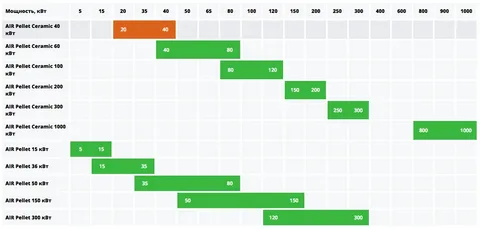

= Проект по разработке

== Общая информация

== Цели внедрения проекта
/пример нумерованного списка

. цель 1
. цель 2

== Описание проекта
* Ключевые задачи
* методология
* ссылка на проект

== roadmap проекта

== Команда проекта
[cols="2,1", options="header"]
|===
|Должность|Кол-во
.3+|Teamlead|1
|Системный аналитик|2
|аналитик|2
|Системный аналитик|2
|Системный архитектор|6
2+|FS разработчик|1
|===

https://localhost:8080[ссылка на репо]

link:../api/OpenApi_Sunset.yaml[OpenAPISpec]

[plantuml]
....
@startuml
participant Participant as Foo
actor Actor as Foo1
boundary Boundary as Foo2
control Control as Foo3
entity  Entity as Foo4
database Database as Foo5
collections Collections as Foo6
queue Queue as Foo7
Foo -> Foo1 : To actor
Foo -> Foo2 : To boundary
Foo2 -> Foo3 : To control
Foo -> Foo4 : To entity
Foo -> Foo5 : To database
Foo -> Foo6 : To collections
Foo -> Foo7 : To queue
@enduml
....